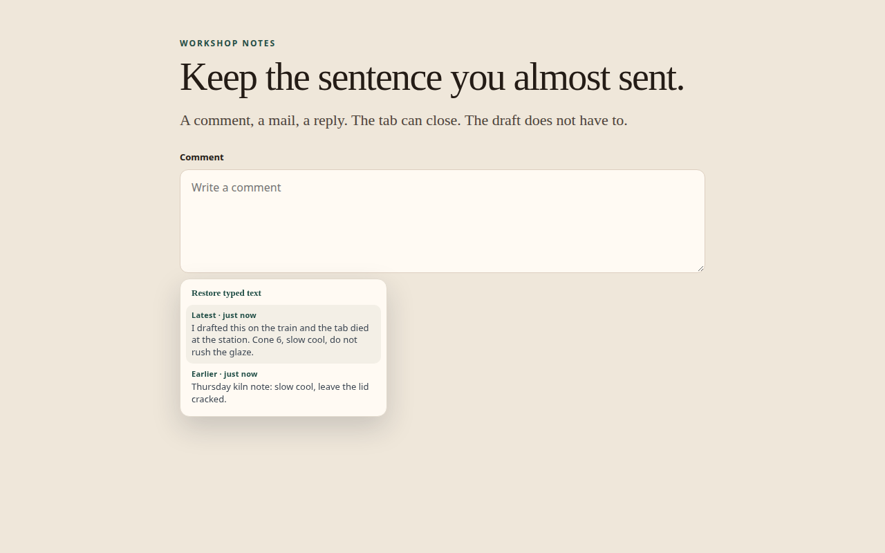
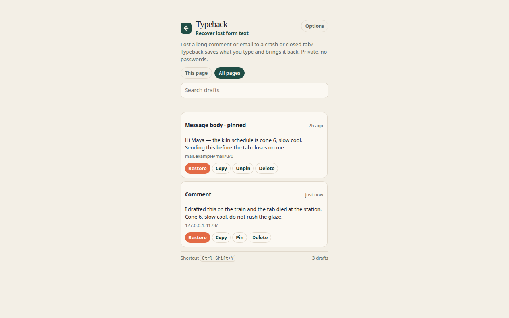
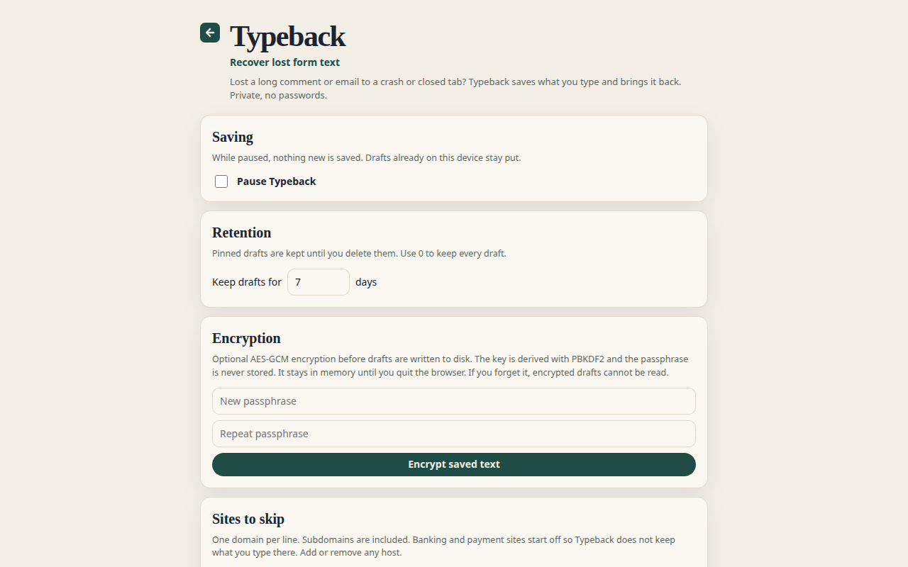

# Typeback

**Typeback: Recover Lost Form Text**

Lost a long comment or email to a crash or closed tab? Typeback saves what you type and brings it back. Private, no passwords.

Typeback is a local-first form recovery extension for Chrome (Manifest V3). It is a spiritual successor to Typio Form Recovery / Lazarus: it quietly keeps text you type into web forms so you can put it back after a crash, a closed tab, a session timeout, or a failed submit.



## What it does

- Autosaves text fields, textareas, and contenteditable editors (comment boxes, mail compose, docs-style editors) about half a second after you type, and again when the field blurs.
- Keys each draft by origin, normalized page URL, and a field identity built from the accessible name, `name`, stable `id`, and form. Generated framework ids are ignored. A short version history is kept for each field.
- Skips passwords, hidden fields, credit-card autocomplete (`cc-*`), one-time codes, new-password fields, and anything that looks like an OTP, PIN, CVV, or account number. `data-typeback="off"` opts a field out.
- Leaves banking and payment sites off by default. You can edit that blocklist.
- Can encrypt drafts on disk with AES-GCM. The key is derived from a passphrase with PBKDF2 (210,000 iterations of SHA-256). The passphrase is never written down; it stays in memory until you quit the browser.
- Drops unpinned drafts after 7 days by default. Retention is configurable, including “keep until I delete them.”
- Shows a small **Restore typed text** chip when you focus an empty field that has a draft. The same recovery is on the right-click menu as **Restore typed text…** and on the shortcut Ctrl+Shift+Y (Command+Shift+Y on Mac).
- Popup lists drafts for this page and for every page, with search, copy, restore into the focused field, delete, and pin.
- Options cover pause, retention, encryption, the blocklist, JSON export/import, and storage use.
- Follows same-origin iframes and open shadow roots, including editors mounted there. Closed shadow roots are not readable, which is a browser limit, not a toggle.

Nothing is uploaded. There is no account and no analytics. See [PRIVACY.md](PRIVACY.md).





## Install from source

Requires Node.js 22+ and Chrome or Chromium 116+.

```bash
npm install
npm test
npm run build
```

1. Open `chrome://extensions`.
2. Turn on Developer mode.
3. Choose **Load unpacked** and select the `dist` folder.

`npm run zip` rebuilds and writes `typeback-<version>.zip` for the Chrome Web Store or for sideloading.

To change the shortcut, open `chrome://extensions/shortcuts`.

## Develop

```bash
npm run lint
npm run typecheck
npm test
npm run build
npm run test:e2e
```

Unit tests cover field identity, sensitive-field exclusion, encryption, retention, and version history. The Playwright test loads the built extension in headless Chromium, types into a local page, reloads, and restores the text. It also checks that a password and a card number are not stored, and that an open shadow root and a same-origin iframe restore.

`npm run assets` redraws the toolbar icons and the 440×280 promo tile. `npm run capture` refreshes the 1280×800 screenshots from the built extension.

## Permissions

| Permission | Why |
| --- | --- |
| `storage` | Drafts, settings, and the optional encryption header live in `chrome.storage.local` on this device. The passphrase, when the vault is unlocked, lives only in `chrome.storage.session` (memory). |
| `contextMenus` | Adds **Restore typed text…** to the menu for editable fields. |
| `alarms` | Runs retention cleanup about once an hour while the browser is open. |
| Content scripts on `http://*/*` and `https://*/*` | Typeback has to see the text you type in order to save it. The script runs in the page’s isolated world. It does not add host permissions beyond that, and it does not send the text anywhere. |

## Privacy

Drafts stay on the computer. Encryption is optional and local. Passwords and payment fields are not saved. Banking domains start on the blocklist. Details and the Chrome Web Store data-use answers are in [PRIVACY.md](PRIVACY.md) and [STORE_LISTING.md](STORE_LISTING.md).

## License

MIT. See [LICENSE](LICENSE).
